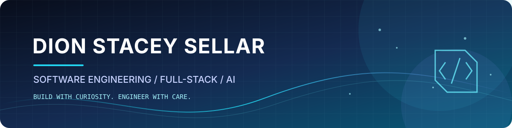
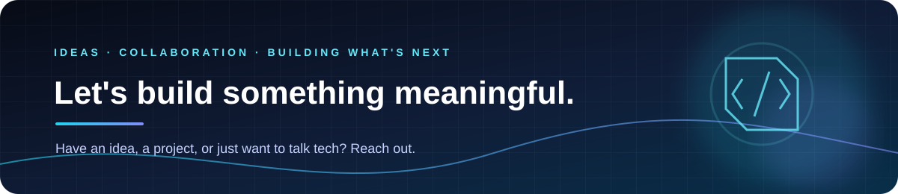

<!-- ===================== PROFILE HEADER ===================== -->

  
  
  

---

<!-- ===================== ABOUT ME ===================== -->
<h2 align="center">👋 Hello, I'm Dion</h2>

<strong>SOFTWARE ENGINEERING UNDERGRADUATE · FULL-STACK DEVELOPER · AI ENTHUSIAST</strong>

  

  <strong>Hey, I'm Dion Stacey Sellar.</strong> 
  I'm studying Software Engineering at <strong>NSBM Green University</strong>, 
  following a <strong>BSc (Hons) Software Engineering degree from the University of Plymouth.</strong>

  <em>I enjoy turning ambitious ideas into useful, thoughtfully engineered software.</em>

---

### ✦ A little about what drives me

I love the process of taking an idea from its first sketch to a working product. Whether I'm building a responsive web application, experimenting with AI, or strengthening a backend, I focus on making software useful, reliable, and enjoyable to use.

<table>
  <tr>
    <td width="50%" valign="top">
      <h3>⚡ WHAT I BUILD</h3>
      
Full-stack web applications, productivity tools, developer experiences, and practical software that solves real problems.

    </td>
    <td width="50%" valign="top">
      <h3>🤖 WHAT I'M EXPLORING</h3>
      
AI-powered applications, local LLMs, computer vision, and intelligent workflows that make software more capable.

    </td>
  </tr>
  <tr>
    <td width="50%" valign="top">
      <h3>🧩 WHAT I'M LEARNING</h3>
      
Backend architecture, API design, databases, software quality, and the engineering principles behind reliable systems.

    </td>
    <td width="50%" valign="top">
      <h3>🌱 HOW I WORK</h3>
      
Stay curious, build consistently, test carefully, learn from feedback, and improve every iteration.

    </td>
  </tr>
</table>

<h3>⚡ WHAT I'M INTO RIGHT NOW</h3>

<table align="center" width="90%">
  <tr>
    <td align="center" width="25%">
      <h2>🌐</h2>
      <strong>FULL-STACK</strong> 
      End-to-end web apps
    </td>
    <td align="center" width="25%">
      <h2>🤖</h2>
      <strong>ARTIFICIAL INTELLIGENCE</strong> 
      Useful AI-powered tools
    </td>
    <td align="center" width="25%">
      <h2>👁️</h2>
      <strong>COMPUTER VISION</strong> 
      Visual intelligence
    </td>
    <td align="center" width="25%">
      <h2>⚙️</h2>
      <strong>BACKEND ENGINEERING</strong> 
      Reliable systems & APIs
    </td>
  </tr>
</table>

 

<strong>MY ENGINEERING MINDSET</strong>

<blockquote>
  
<em>“Build with curiosity. Engineer with care. Make every iteration count.”</em>

</blockquote>

ALWAYS EXPLORING · ALWAYS BUILDING · ALWAYS IMPROVING

## 🚀 Featured Projects

A selection of projects across AI, productivity, computer vision, and full-stack application development.

<table>
  <tr>
    <td width="50%" valign="top">
      <h3>🤖 OPTIVEX AI</h3>
      
Browser-based computer-vision workspace for face detection, image analysis, facial landmarks, and consent-based profile matching.

      
<a href="https://optivex-ai-delta.vercel.app">Live Application</a> · <a href="https://github.com/dionstacey03-dev/optivex-ai">Source Code</a>

      
React · TypeScript · Vite · TensorFlow.js · Face API

    </td>
    <td width="50%" valign="top">
      <h3>🧠 NEXORA AI</h3>
      
AI-powered project planning workspace for turning ideas into structured blueprints, architecture plans, roadmaps, and starter code.

      
<a href="https://nexora-ai-topaz-eight.vercel.app/">Live Application</a> · <a href="https://github.com/dionstacey03-dev/nexora-ai">Source Code</a>

      
React · TypeScript · Express · Google Gemini

    </td>
  </tr>
  <tr>
    <td width="50%" valign="top">
      <h3>📚 STUDIQ AI</h3>
      
AI study workspace with tutoring, notes summarisation, adaptive quizzes, spaced-repetition flashcards, and study analytics.

      
<a href="https://studiq-ai-zeta.vercel.app/">Live Application</a> · <a href="https://github.com/dionstacey03-dev/studiq-ai">Source Code</a>

      
React · TypeScript · Tailwind CSS · Gemini · Vercel Functions

    </td>
    <td width="50%" valign="top">
      <h3>⚡ FocusFlow Mini</h3>
      
Mobile-first productivity app featuring a Pomodoro timer, task management, focus history, and progress tracking.

      
<a href="https://focusflow-mini.vercel.app">Live Application</a> · <a href="https://github.com/dionstacey03-dev/focusflow-mini">Source Code</a>

      
React · Vite · CSS · Local Storage

    </td>
  </tr>
  <tr>
    <td width="50%" valign="top">
      <h3>🌿 GreenRoute AI</h3>
      
Eco-conscious route comparison prototype with map visualisation, road routing, preference-based ranking, and transparent travel estimates.

      
<a href="https://github.com/dionstacey03-dev/GreenRoute-AI">Source Code</a>

      
React · FastAPI · Python · Leaflet · PostgreSQL

    </td>
    <td width="50%" valign="top">
      <h3>✨ QR Studio</h3>
      
Customisable QR generator and scanner with branded templates, live previews, export options, and a responsive Liquid Glass interface.

      
<a href="https://qr-studio-fawn-three.vercel.app">Live Application</a> · <a href="https://github.com/dionstacey03-dev/qr-studio">Source Code</a>

      
React · Vite · JavaScript · CSS

    </td>
  </tr>
  <tr>
    <td width="50%" valign="top">
      <h3>🛍️ VELTRIX Marketplace</h3>
      
Glassmorphic e-commerce marketplace with customer, seller, and admin experiences, AI shopping tools, and Firebase integration.

      
<a href="https://veltrix-marketplace.vercel.app">Live Application</a> · <a href="https://github.com/dionstacey03-dev/veltrix-marketplace">Source Code</a>

      
React · TypeScript · Tailwind CSS · Express · Gemini · Firebase

    </td>
    <td width="50%" valign="top">
      <h3>🎙️ JARVIS AI Assistant</h3>
      
Local-first Windows desktop assistant with voice interaction, wake-word mode, desktop actions, persistent memory, and optional Ollama models.

      
<a href="https://github.com/dionstacey03-dev/JARVIS-AI-Assistant">Source Code</a>

      
Python · Tkinter · Ollama · Edge TTS

    </td>
  </tr>
</table>

**More work:** [Browse all public repositories →](https://github.com/dionstacey03-dev?tab=repositories)

## 🧰 Technology Stack

### Languages

  

### Frameworks, Libraries & Platforms

  

### AI & Developer Tools

  
  
  
  

## 📊 GitHub Overview

  
  
   
  

Statistics and language breakdowns are generated by external services and may be affected by their availability or caching.

<!-- ===================== CONTRIBUTIONS & CURRENT FOCUS ===================== -->
<h2 align="center">🏆 Contribution Highlights</h2>

<strong>MAKING PROGRESS, ONE COMMIT AT A TIME.</strong>

  Building in public. Learning by doing. Turning ideas into working software.

<table align="center" width="90%">
  <tr>
    <td align="center" width="33%">
      <h2>💻</h2>
      <strong>BUILD</strong> 
      Practical projects and real-world solutions.
    </td>
    <td align="center" width="33%">
      <h2>🧠</h2>
      <strong>LEARN</strong> 
      New tools, better architecture, deeper skills.
    </td>
    <td align="center" width="33%">
      <h2>⚡</h2>
      <strong>IMPROVE</strong> 
      Refine, test, document, and keep shipping.
    </td>
  </tr>
</table>

**[⌘ EXPLORE REPOSITORIES](https://github.com/dionstacey03-dev?tab=repositories)** &nbsp; · &nbsp; **[↗ VIEW GITHUB ACTIVITY](https://github.com/dionstacey03-dev?tab=overview)**

Visit my GitHub profile for the live contribution calendar and activity history.

---

<h2 align="center">🎯 What I'm Focused On</h2>

<table>
  <tr>
    <td width="50%" valign="top">
      <h3>🚀 Full-Stack Engineering</h3>
      Building responsive applications and connecting polished frontends with reliable backend services.
    </td>
    <td width="50%" valign="top">
      <h3>🧩 Backend & Architecture</h3>
      Strengthening API design, database fundamentals, system structure, and maintainable code.
    </td>
  </tr>
  <tr>
    <td width="50%" valign="top">
      <h3>🤖 Applied AI</h3>
      Exploring practical AI integrations, local models, and intelligent workflows that solve real problems.
    </td>
    <td width="50%" valign="top">
      <h3>🛡️ Quality & Security</h3>
      Improving reliability through testing, security reviews, debugging, and clear documentation.
    </td>
  </tr>
  <tr>
    <td width="50%" valign="top">
      <h3>🎨 UI & Experience</h3>
      Creating accessible, responsive interfaces with thoughtful details and consistent design.
    </td>
    <td width="50%" valign="top">
      <h3>🌱 Continuous Growth</h3>
      Learning through experimentation, feedback, iteration, and shipping projects from start to finish.
    </td>
  </tr>
</table>

  FOCUS ON THE FUNDAMENTALS · BUILD WITH INTENTION · NEVER STOP ITERATING

## 🤝 Let's Connect

 

  
  
  

 

<h3 align="center">✦ THE NEXT GREAT THING STARTS WITH A CONVERSATION ✦</h3>

<table>
  <tr>
    <td align="center" width="33%" valign="top">
       
      <h2>💡</h2>
      <strong>HAVE AN IDEA?</strong>
        
      Got a concept worth building? Let's turn that spark into something real.
        
      <a href="mailto:dion.stacey03@gmail.com?subject=I%20have%20an%20idea">LET'S TALK ↗</a>
        
    </td>
    <td align="center" width="33%" valign="top">
       
      <h2>🤝</h2>
      <strong>LET'S COLLABORATE</strong>
        
      Open to meeting creative minds, exchanging ideas, and building useful things together.
        
      <a href="https://www.linkedin.com/in/dion-stacey-sellar-1066a7339/">CONNECT WITH ME ↗</a>
        
    </td>
    <td align="center" width="33%" valign="top">
       
      <h2>☕</h2>
      <strong>JUST SAY HELLO</strong>
        
      Tech chat, feedback, questions, or a friendly hello — my inbox is open.
        
      <a href="mailto:dion.stacey03@gmail.com?subject=Hello%20Dion">SAY HELLO ↗</a>
        
    </td>
  </tr>
</table>

 

<h2 align="center">✦ THANKS FOR STOPPING BY ✦</h2>

<table>
  <tr>
    <td align="center">
      <h3>⚡ BUILD BOLDLY</h3>
      Turn ideas into action.
    </td>
    <td align="center">
      <h3>🧠 STAY CURIOUS</h3>
      Keep learning. Keep exploring.
    </td>
    <td align="center">
      <h3>🚀 SHIP WITH PURPOSE</h3>
      Create things that matter.
    </td>
  </tr>
</table>

  <strong>SOFTWARE WITH INTENTION. PROGRESS WITH EVERY ITERATION.</strong>

  © 2026 <strong>Dion Stacey Sellar</strong>
   
  Built with curiosity · Refined with care · Powered by ☕

